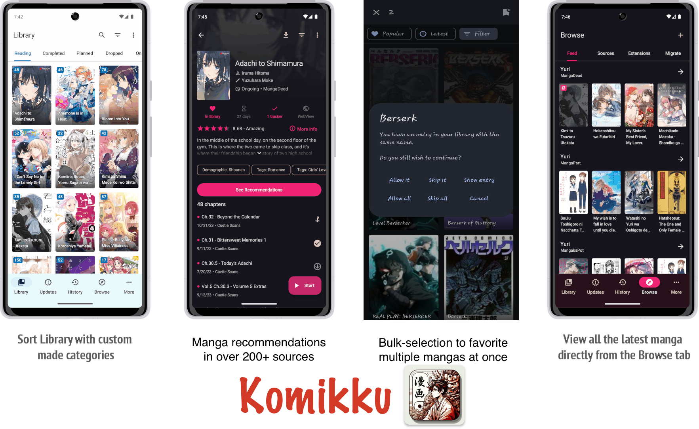

 
 <h1 align="center"> Komikun </h1>

**Komikun** is a personal vendoring fork of [Komikku](https://github.com/komikku-app/komikku).
Komikku is itself derived from TachiyomiSY, which in turn builds on Mihon (the original Tachiyomi).
This fork keeps the upstream feature set and adds its own work on top; it does not claim the
upstream features as its own. See [FORK.md](./FORK.md) for the upstreams it tracks.

| Nightly |
|---------|
| 
    
 |

*Requires Android 8.0 or higher.*

*The [Discord server](https://discord.gg/85jB7V5AJR) behind that badge, and the [Komikku website and
FAQ](https://komikku-app.github.io/), are **upstream Komikku** resources: useful, but not run by this fork.*

## Download

A free and open source manga reader, forked from [Komikku](https://github.com/komikku-app/komikku) —
which is itself built on TachiyomiSY and Mihon. This fork keeps that feature set, takes fixes and
features from Komikku, Mihon and TachiyomiSY as they land, and adds its own work on top.

## Features

### Komikun additions
What actually originates in this fork, on top of the upstream chain:

- **Dictionary lookup.** Import Yomitan dictionaries and look words up — from the Dictionary screen,
  and in the reader by tapping a recognised word on the OCR overlay — with per-profile dictionary
  ordering and word audio.
- **Manga OCR.** PaddleOCR PP-OCRv6 on ONNX Runtime, plus `.mokuro` sidecars, with tappable text boxes
  drawn over the page, a per-chapter OCR queue fed by the download pipeline, and selectable
  detector × recogniser models.
- **AnkiDroid mining.** Send a lookup or an OCR crop to AnkiDroid as a card, with deck / note type /
  field mapping, duplicate checks, profiles and screenshot crop presets.
- **One explicit, default-off switch for all three.** Nothing runs — engine, model download, import,
  overlay, reader tap handling — until you answer, and you are asked once: in onboarding on a fresh
  install, or through a one-time screen after upgrading.
- **History category filter.** Filter the History screen by library category.
- **Orphaned-download cleanup.** Delete chapter downloads that no surviving chapter can name any more —
  automatically when a chapter disappears from a library update or a device sync, or from a
  Settings → Downloads scan you can review and confirm.
- **Nightly-only releases, with the update APK verified before install.** Releases are cut by commit count
  (`r<count>` tags), and the downloaded update APK's SHA-256 is checked against the release asset digest
  before install — a mismatch deletes the download.

### Inherited from Komikku
Everything below is [Komikku](https://github.com/komikku-app/komikku)'s feature list, inherited by this
fork — not written by it. Komikku is itself derived from TachiyomiSY and Mihon, so its list carries
theirs too.

- `Suggestions` automatically showing source-website's recommendations / suggestions / related to current entry for all sources.
- `Hidden categories` to hide yours things from *nosy* people.
- `Auto theme color` based on each entry's cover for entry View & Reader.
- `App custom theme` with `Color palettes` for endless color lover.
- `Bulk-favorite` multiple entries all at once.
- Source & Language icon on Library & various places. (Some language flags are not really accurate)
- `Feed` now supports **all** sources, with more items (20 for now).
- Fast browsing (for who with large library experiencing slow loading)
- Grouped entries in Update tab (inspired by J2K).
- Update notification with manga cover.
- Auto `2-way sync` progress with trackers.
- Chips for `Saved search` in source browse
- `Panorama cover` showing wide cover in full.
- `Merge multiple` library entries together at same time.
- `Range-selection` for Migration.
- Ability to `enable/disable repo`, with icon.
- `Update Error` screen & migrating them away.
- `to-be-updated` screen: which entries are going to be checked with smart-update?
- `Search for sources` & Quick NSFW sources filter in Extensions, Browse & Migration screen.
- `Feed` backup/restore/sync/re-order.
- Long-click to add/remove single entry to/from library, everywhere.
- Docking Read/Resume button to left/right.
- In-app progress banner shows Library syncing / Backup restoring / Library updating progress.
- Auto-install app update.
- Configurable interval to refresh entries from downloaded storage.
- Everything from TachiyomiSY and Mihon, which Komikku builds on.
- Kept current with Mihon and TachiyomiSY upstream by Komikku.
- More app themes & better UI, improvements...

  
Features from Mihon / Tachiyomi

#### All up-to-date features from Mihon / Tachiyomi (original), include:

* Online reading from a variety of sources
* Local reading of downloaded content
* A configurable reader with multiple viewers, reading directions and other settings.
* Tracker support: [MyAnimeList](https://myanimelist.net/), [AniList](https://anilist.co/), [Kitsu](https://kitsu.app/), [MangaUpdates](https://mangaupdates.com), [Shikimori](https://shikimori.io), [Bangumi](https://bgm.tv/)
* Categories to organize your library
* Light and dark themes
* Schedule updating your library for new chapters
* Create backups locally to read offline or to your desired cloud service
* Continue reading button in library

  
Features from Tachiyomi SY

#### All features from TachiyomiSY:
* Feed tab, where you can easily view the latest entries or saved search from multiple sources at same time.
* Automatic webtoon detection, allowing the reader to switch to webtoon mode automatically when viewing one
* Manga recommendations, uses MAL and Anilist, as well as Neko Similar Manga for Mangadex manga (Thanks to Az, She11Shocked, Carlos, and Goldbattle)
* Lewd filter, hide the lewd manga in your library when you want to
* Tracking filter, filter your tracked manga so you can see them or see non-tracked manga, made by She11Shocked
* Search tracking status in library, made by She11Shocked
* Custom categories for sources, liked the pinned sources, but you can make your own versions and put any sources in them
* Manga info edit
* Manga Cover view + share and save
* Dynamic Categories, view the library in multiple ways
* Smart background for reading modes like LTR or Vertical, changes the background based on the page color
* Force disable webtoon zoom
* Hentai features enable/disable, in advanced settings
* Quick clean titles
* Source migration, migrate all your manga from one source to another
* Saving searches
* Autoscroll
* Page preload customization
* Customize image cache size
* Batch import of custom sources and featured extensions
* Advanced source settings page, searching, enable/disable all
* Click tag for local search, long click tag for global search
* Merge multiple of the same manga from different sources
* Drag and drop library sorting
* Library search engine, includes exclude, quotes as absolute, and a bunch of other ways to search
* New E-Hentai/ExHentai features, such as language settings and watched list settings
* Enhanced views for internal and integrated sources
* Enhanced usability for internal and delegated sources

Custom sources:
* E-Hentai/ExHentai

Additional features for some extensions, features include custom description, opening in app, batch add to library, and a bunch of other things based on the source:
* 8Muses (EroMuse)
* HentaiNexus
* Hitomi.la
* Mangadex
* NHentai
* NineHentai
* Puruin
* LANraragi

## Issues, Feature Requests and Contributing

Pull requests are welcome. For major changes, please open an issue first to discuss what you would like to change.

Issues

[Upstream Komikku website](https://komikku-app.github.io/) — run by the Komikku project, not by this fork.

1. **Before reporting a new issue, take a look at the [upstream Komikku FAQ](https://komikku-app.github.io/docs/faq/general), the [changelog](https://github.com/komi-kun/komi-kun/releases) and the already opened [issues](https://github.com/komi-kun/komi-kun/issues).**
2. If you are unsure, ask in the upstream Komikku community: 

Bugs

* Include version (More → About → Version)
 * If not latest, try updating, it may have already been solved
 * Preview version is equal to the number of commits as seen on the main page
* Include steps to reproduce (if not obvious from description)
* Include screenshot (if needed)
* If it could be device-dependent, try reproducing on another device (if possible)
* Don't group unrelated requests into one issue

Use the [issue forms](https://github.com/komi-kun/komi-kun/issues/new/choose) to submit a bug.

Feature Requests

* Write a detailed issue, explaining what it should do or how.
* Include screenshot (if needed).

Contributing

See [CONTRIBUTING.md](./CONTRIBUTING.md).

Code of Conduct

See [CODE_OF_CONDUCT.md](./CODE_OF_CONDUCT.md).

### Credits

Thank you to all the people who have contributed!

### Disclaimer

The developer(s) of this application does not have any affiliation with the content providers available, and this application hosts zero content.

## License

**The app as distributed is GPL-3.0-or-later.** The repository as a whole, and the binaries built
from it (the "combined work"), are distributed under the GNU General Public License, version 3 or
later. The full text is in [LICENSES/GPL-3.0-or-later.txt](./LICENSES/GPL-3.0-or-later.txt), and
[NOTICE](./NOTICE) records the provenance of the GPL components and of the upstream (Apache-2.0)
projects. That is the license of the APK you install or pass on.

**Why the Apache-2.0 text is still below.** Every file inherited from Mihon, TachiyomiSY and Komikku
stays Apache-2.0 in its own right — Apache-2.0 code may be combined into a GPL-3.0 work — so the
top-level [LICENSE](./LICENSE) is the Apache-2.0 text and those files keep their Apache-2.0 headers.
It does not narrow the GPL-3.0-or-later terms of the combined distribution.

**What that means if you reuse the code.** Taking an upstream-derived file gives you it under
Apache-2.0. Taking this fork's own dictionary/OCR work — the `:core:dictionary` and `:core:ocr`
modules and the app code that implements them, which carry
`SPDX-License-Identifier: GPL-3.0-or-later` headers — gives you it under GPL-3.0-or-later. The
exception is a small set of **GPL-free seam files** — the reader OCR and dictionary interfaces, the
shared dictionary/OCR opt-in preference, and the reader and chapter files (including a SQLDelight
migration and query) they are threaded through: they are Apache-2.0 and import no GPL code precisely
so they can be contributed back upstream to Komikku. The authoritative list is the `SEAM_FILES` array
in [`scripts/verify-gpl-free.sh`](./scripts/verify-gpl-free.sh).

    Copyright 2015 Javier Tomás

    Licensed under the Apache License, Version 2.0 (the "License");
    you may not use this file except in compliance with the License.
    You may obtain a copy of the License at

    http://www.apache.org/licenses/LICENSE-2.0

    Unless required by applicable law or agreed to in writing, software
    distributed under the License is distributed on an "AS IS" BASIS,
    WITHOUT WARRANTIES OR CONDITIONS OF ANY KIND, either express or implied.
    See the License for the specific language governing permissions and
    limitations under the License.
